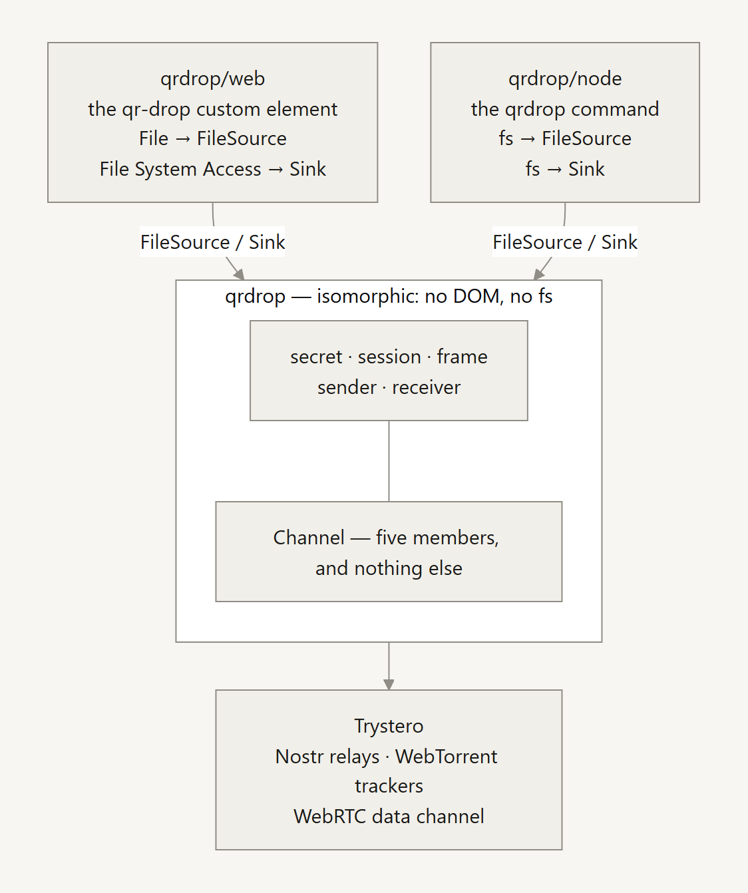

# Protocol

How qrdrop pairs two devices, derives its keys, and moves a file, and the
design decisions behind each step. The [README](../README.md#how-it-works) has
the short version; the [threat model](threat-model.md) says what all of this
does and does not protect. [Networking, end to end](networking.md) follows a
transfer across the network, and says which route carries the file.

## Pairing and keys

Two devices in the same room. One shows a QR code, the other points a camera at
it, and that scan is the one channel an attacker cannot stand in the middle of.

<!-- Source: docs/diagrams/handshake.mmd, rendered by scripts/make-diagrams.mjs.
     A ```mermaid fence would be tidier and renders on GitHub, but not on npm,
     which shows the README too. The alt text is the diagram in words -- it is
     what a screen reader gets, and what the ASCII sketch this replaced gave. -->
<picture>
  <source media="(prefers-color-scheme: dark)" srcset="diagrams/handshake.dark.png">
  
</picture>

The QR carries 32 bytes of CSPRNG output. Everything else derives from it:

| Derivation | Purpose |
| --- | --- |
| `HKDF(secret, "topic")` | Trystero room ID — what peers meet on |
| `HKDF(secret, "signal")` | Trystero `password`, encrypting session descriptions |
| `HKDF(secret, "lan-rendezvous")` | the HMAC key of the offline rendezvous, for a code that carries an address (below) |
| `HKDF(ECDH, salt=secret, "host->guest")` | file bytes, sender to receiver |
| `HKDF(ECDH, salt=secret, "guest->host")` | file bytes, the other way |
| `HKDF(ECDH, salt=secret, "sas")` | the four emoji shown on both screens |
| `HKDF(ECDH, salt=secret, "pick")` | 16 bytes the host sends on the `pick` action, saying which network it kept |

Pairing joins every signalling network at once, and each side keeps the first
one to finish its key exchange. Nothing used to make the two sides agree, so
when two networks finished within a few milliseconds the host could keep one
and the guest the other, and they would show SASes that disagree with no
attacker anywhere. The host now sends the pick on the room it kept, before
either side shows its SAS. Only a holder of that session can derive it, so a
guest can follow it without being steered by a stranger holding the code.
Guests do not act on it yet; [the design note](notes/pairing-race.md) has the
order this ships in and why.

The room ID is derived rather than being the secret itself. Using the secret as
the room name is the obvious shortcut, works perfectly in testing, and silently
publishes your key to every relay on the network.

### Why `password` is not optional

Trystero owns the session descriptions, so we cannot seal the SDP ourselves.
`password` is what replaces that. Without it Trystero derives its key from the
app ID and room name — both of which any relay observer already has — which
would leave the DTLS fingerprint substitutable in transit. That substitution is
the textbook man-in-the-middle on WebRTC signalling, and it is the thing the QR
code exists to prevent.

### Why file chunks are encrypted again on top

Two layers that fail independently. Ephemeral ECDH per session gives forward
secrecy — a code photographed later cannot decrypt a transfer that already
happened — and it uses the QR secret as its HKDF salt, so even if Trystero's
signalling encryption were broken outright an attacker would still need the code
to derive the session key.

"Per session" is the load-bearing word, and it rests on one line: the keypair is
generated inside `joinVia`, per call, and thrown away with the room. Since
`openRoom` races two signalling networks at once, one pairing generates two
keypairs and discards one — which makes lifting that line to module scope look
like an easy saving and would quietly turn every transfer a process ever made
into one long session. `test/room.test.mjs` pairs twice over the same secret
against an in-memory signalling strategy and asserts the second session cannot
decrypt the first's traffic, so that edit fails a test in two seconds rather than
surviving to a release.

DTLS also terminates at the peer's browser, and when NAT traversal fails packets
pass through a third-party TURN relay. Sealing each chunk ourselves means a
relay operator sees ciphertext and byte counts, never contents.

Nonces are unique by counting rather than by chance — `fileSeq || chunkIndex`,
with a separate key per direction — because AES-GCM does not degrade gracefully
under nonce reuse. The end-of-file flag is authenticated, so an attacker who
stops forwarding frames cannot pass a truncated file off as complete.

### Two gestures, and why neither is decorative

The sender confirms the four-emoji SAS before a manifest goes out — the manifest
alone would disclose the filename and size. The receiver accepts, which is also
the click that permits `showSaveFilePicker` to open, and that is what lets large
files stream to disk instead of accumulating in memory.

> [!IMPORTANT]
> Both gestures survive into the CLI as stdin prompts. `--yes` skips the accept
> prompt and **cannot** skip the SAS confirmation: the SAS is the entire
> man-in-the-middle defence, so a flag that skipped it would be a vulnerability
> wearing a convenience's clothes.

## Three faces, one protocol

```js
import { openRoom, sendFile, createReceiver } from 'qrdrop'        // isomorphic
import { defineQRDrop, fromFile } from 'qrdrop/web'                // browser
import { fromPath, createFileSink } from 'qrdrop/node'             // Node
```

<!-- Source: docs/diagrams/entries.mmd, rendered by scripts/make-diagrams.mjs.
     A ```mermaid fence would be tidier and renders on GitHub, but not on npm,
     which shows the README too. The alt text is the diagram in words -- it is
     what a screen reader gets, and what the ASCII sketch this replaced gave. -->
<picture>
  <source media="(prefers-color-scheme: dark)" srcset="diagrams/entries.dark.png">
  
</picture>

The `qrdrop` entry is the protocol and the transport, and it touches neither a
DOM nor an `fs`. That is enforced rather than asserted: `src/core/` and
`src/transport/` are typechecked twice, once with `types: []` and no Node lib
and once with Node's globals, so a stray `Buffer` in code destined for a browser
fails the build instead of throwing at runtime.

What is deliberately *not* in that entry is anything that knows where bytes come
from or go to. `sendFile` takes a `FileSource`, `createReceiver` takes a
`createSink`, and each runtime supplies its own. That is the whole trick behind
having a CLI at all.

### Drop the UI into a page

```html
<script type="module">
  import { defineQRDrop } from 'qrdrop/web'
  defineQRDrop()
</script>

<qr-drop></qr-drop>
```

A custom element with its own shadow root, so it brings its styles with it and
collides with nothing. No framework, and no framework adapter to keep up to
date — every framework already renders a custom element.

### Run the browser UI locally

`npx qrdrop web` serves the same browser UI that [share.stan-ely.com](https://share.stan-ely.com)
deploys, from the package you just installed, on `http://127.0.0.1:4173` — nothing
is uploaded and no other device can reach it. It is the way to use the browser
flow while running code you can read first.

| Flag | |
| --- | --- |
| `--port <n>` | changes the port; `0` picks a free one |
| `--no-open` | prints the URL instead of opening a browser |
| `Ctrl-C` | stops it |

Loopback only, by design: `http://<lan-ip>` is not a secure context, so
WebCrypto and the camera would fail there.

To host the built bundle yourself, see [hosting.md](hosting.md).

## Design notes

### The transport seam

Everything in `src/core/` is written against one interface and nothing else:
`Channel` in `types/qrdrop.d.ts`. Five members — `send`, `bufferedAmount`,
`bufferedAmountLowThreshold`, and the `addEventListener` / `removeEventListener`
pair.

That seam is why replacing the entire signalling layer — hand-rolled Nostr plus
WebRTC negotiation, for Trystero — cost 11 lines across all of the transfer code
and nothing at all in the framing, session, control, digest, or sink modules.
The security core was untouched by a total rewrite beneath it.

> [!IMPORTANT]
> The one subtlety worth knowing before writing another transport:
> **backpressure may be signalled either way, but it must be signalled.** A
> transport can defer the promise returned by `send`, or it can report
> `bufferedAmount` and fire `bufferedamountlow` — Trystero does the former, a
> raw `RTCDataChannel` the latter. A transport that does neither will let a
> large file queue entirely into memory and take the tab down.
> `test/channel.test.mjs` runs a full sealed transfer over a channel with
> exactly those five members and nothing else, so a new transport finds out
> what it is missing there rather than against a live relay.

<details>
<summary><b>More than one signalling network, raced</b></summary>

Trystero ships a package per strategy behind an identical `joinRoom` interface,
so `src/transport/room.js` lists them in `STRATEGIES` — Nostr relays and
WebTorrent trackers today — and `openRoom` joins all of them at once, pairs on
whichever completes the handshake first, and tears the rest down. Both peers are
present on every network simultaneously, so no agreement on *which* network is
needed; a sequential fallback could not promise that. The tracker strategy
shares Trystero's core and costs ~2 kB gzipped; `/mqtt` was measured at ~112 kB
and left out, `/ws-relay` would mean running a server. Adding a strategy is one
entry in `STRATEGIES` and its URL list — the CSP follows automatically, because
`scripts/build-site.mjs` generates `connect-src` from `SIGNALING_URLS` (every
strategy's URLs, reduced to origins) rather than a second list kept in step by
hand.

</details>

<details>
<summary><b>Relay choice was measured, not assumed</b></summary>

The best-known Nostr relays — `relay.damus.io`, `relay.nostr.band`,
`relay.snort.social` — were all unreachable when the list was built. The seven
in `room.js` were picked by connecting to every relay in Trystero's pool and
keeping the ones that answered. The tracker list is seeded from
`@trystero-p2p/torrent`'s defaults and has not had the same publish-test
scrutiny yet.

**Measure by publishing, not by connecting.** `relay.nostr.place` was dropped
after it began demanding proof-of-work (NIP-13) on writes. It still accepts
connections and still answers reads, so a connectivity probe calls it healthy —
it just cannot be used to announce a peer, which is the only thing a relay is
needed for here. A socket that opens is not a relay that works.

</details>

<details>
<summary><b>The local-network fast path, and the one moment it can switch</b></summary>

A WebRTC data channel levels off at 14–17 MB/s even on one network. That limit
comes from SCTP's congestion control, and nothing in JavaScript can change it.
A WebSocket between the same two devices runs over the OS's TCP. It measured
about 4× the data channel in a network namespace and about 6× on a phone over
Wi-Fi; the figures are in `app/CAPABILITIES.md`. So when both ends are native
(the CLI or the app), `src/transport/lan.js` moves the sender's frames onto a
direct WebSocket. The website never does this: a page cannot accept a
connection, and only the app registers the platform hook.

- **The frames are the same frames.** They go into the same handler, face the
  same tag check and ordering checks, and a frame that fails its tag is
  counted and dropped just as before. The socket makes the transfer faster; it
  is not trusted any more than WebRTC is.
- **Nothing is said before the SAS.** The sender's `lan-hello` goes out after
  its confirm, and the receiver speaks only in reply. The listener's
  `lan-offer` names its addresses and a 16-byte token, sealed like every other
  control message. The side that dials in presents the token first, and the
  listener takes exactly one connection that does, then stops listening.
- **The listener proves itself back.** The offer also carries a 16-byte
  `answer`, random and independent of the token. A dialler that has one sends
  the token followed by the byte `0x01`, and takes the link only if the reply
  is the answer. Without it, anyone on the path who took the connection could
  reply with the one-byte ACK the protocol used to end on, become the link,
  and stall the transfer, since LAN wins over every other path. An answer
  derived from the token would not stop them, because the dialler has already
  sent them the token. An offer without an `answer` comes from an older
  listener, and there the dialler accepts ACK. An older dialler sends the bare
  token and is answered ACK. Since the offer is sealed, nobody else can strip
  the answer to force the older exchange.
- **A link carries the file only once a frame over it passes its tag.** A
  receiver that loses a link it believes the file is on fails the transfer,
  so counting from the first message would let one junk frame and a close end
  a transfer that was arriving whole by another way.
- **Only a quiet side listens.** Listening on Windows, and for an unsigned
  macOS app, raises an OS firewall prompt. Each hello says whether it would,
  and when neither side can listen quietly, the transfer stays on WebRTC.
- **The switch happens at Accept, and only there.** A frame on a second
  channel can overtake one still in flight on the first, and an authenticated
  frame that arrives out of order is fatal. When the sender reads the peer's
  accept, every frame it has sent over WebRTC is one the receiver has provably
  handled. From that moment every frame this side sends goes over the socket,
  and the receiver's replies never move. `sendFile`'s `onAccept` is the hook.
- **Older builds are unaffected.** They drop both messages as unknown types.
  The receiver's hello is queued ahead of its Accept, so a sender that sees
  Accept without a hello knows at once that the peer is an older build, and
  never waits.

The app listens through a relay in its own Rust process (`src-tauri/src/lan.rs`),
which its page reaches over `127.0.0.1`. It uses a relay rather than IPC
because, on Android, IPC carries bytes as base64 inside JSON. `--no-lan` turns
the fast path off for the CLI.

</details>

<details>
<summary><b>The QUIC path, when both ends run the Rust session</b></summary>

When both ends run the Rust session (the Rust CLI today), the sender's frames
can move onto a direct QUIC connection instead. Over a clean round trip it
measured four to five times the WebRTC data channel, whose SCTP receive
window caps it at about 1 MiB per round trip, and five to thirty-five times
under packet loss. The numbers are in `app/CAPABILITIES.md`.
It is the local-network path's design on another transport, and every rule
above holds for it:

- **Nothing is said before the SAS.** The addresses and the certificate
  fingerprint travel in sealed control messages (`quic-hello`, then
  `quic-offer`) after the confirm, never in the signalling. The signalling is
  sealed only with the code's password, so anyone holding the code could read
  it and race the real peer to the address.
- **The connection is pinned.** Each end accepts exactly the certificate the
  other one named, and checks the TLS signature against it. The frames on it
  are the same sealed frames, as untrusted as on WebRTC.
- **It crosses NATs without a relay**, through the common kind that maps a
  socket to one public port whoever it sends to (measured behind two).
  Both sides send first, which opens each NAT towards the other. A pair that
  cannot connect stays on WebRTC, TURN included, after waiting at most three
  seconds at Accept.
- **The switch happens at Accept, and only there.** A browser or the Node CLI
  ignores the sender's `quic-hello` as an unknown type and never answers, so
  the sender knows at Accept that the path is not there and does not wait.
- **The local-network path wins when both are up.** On a phone sending over
  Wi-Fi, the LAN path's kernel TCP measured about half as fast again as QUIC.
  QUIC carries the file where LAN cannot: between networks, or when neither
  end can listen quietly.

`--no-lan` keeps the Rust CLI's file on WebRTC, which turns this path off too.

</details>

<details>
<summary><b>Pairing with no internet, through an address in the code</b></summary>

Every path above is negotiated after pairing, over a room that met on the
public relays. So two devices on one Wi-Fi with no route out could not pair
at all. A phone hotspot with no data, a plane or a site network were all
dead ends. The QR is already the one channel nobody can stand in the middle
of, and the only thing the relays did that the QR could not was say where
the other device is. So the code can say it:

```
qrdrop:<43 characters>.<locator>
```

The locator is base64url of a version byte, a port and one to four private
IPv4 addresses. `.` is outside the base64url alphabet, so the code's own 43
characters stay unambiguous, and in the URL form the whole thing is still in
the fragment. A decoder that does not know the locator's version ignores it,
so the format can grow. The bare form stays valid for good.

- **The side showing the code listens; the scanner dials.** Only the listener
  can say where it is. The Rust CLI and the Node CLI emit a locator with
  `send --offline`, and the app with "Pair without internet" in Settings. All
  of them are off by default: a receiver older than npm 0.7.0 or app 1.4.0
  rejects such a code, and on Windows or macOS listening raises the
  firewall prompt. Every native receiver dials a locator it reads, before any
  relay, for at most three seconds, and says so when it falls back. The
  website cannot open a socket, so it ignores the locator and pairs over the
  relays as before.
- **The code is proved before anything latches.** A relay room cannot even
  be found without the code, but a listening port is open to the whole
  network. So the first four messages on the WebSocket are a rendezvous keyed
  on `k_rv = HKDF(secret, "lan-rendezvous")`. The listener sends a 16-byte
  nonce. The dialler answers with its ECDH key and an HMAC over both, and only
  a valid MAC gets a reply. The listener sends its own key and a MAC over the
  nonce and both keys, and the dialler sends a last MAC, `ok`. A stranger
  without the code is closed with nothing latched and costs one handshake
  slot, never a key. The MACs cover both public keys, so nobody on the path
  can substitute one. That is stronger than the relay path, where catching a
  substitution is the SAS's job.
- **The keys are the room's keys.** Both ends then run the same
  `establishSession` with the secret as salt and the listener as host. The
  session keys and the SAS come out of the same derivation as on every other
  pairing.
- **One roll per secret, across two ways in.** The dialler counts itself
  paired once it has sent `ok`, and the listener once it has checked it.
  Before that point either side may fall back to the relays, because nothing
  has been shown to anyone. After it, any failure is final, like a mismatch.
  The dialler races the addresses only as far as the nonce and keys a single
  connection. Keying every address that answered would give each its own
  keypair, and a listener reachable at two addresses could finish on one
  while the dialler kept the other.
- **The socket carries the whole session.** An offline pairing has no room,
  so the control stream, the manifest, Accept and every frame ride the same
  WebSocket from the first frame (`createSocketRoom` in
  `src/transport/rendezvous.js`, `carrier.rs` in Rust). It is already the
  local path, so neither side offers a LAN or QUIC upgrade.
- **A listener waits on both.** The sender keeps its rooms up beside the
  listener, so a receiver that cannot reach the address still pairs over the
  relays. With every relay unreachable it keeps waiting on the listener
  rather than giving up, since that is the network it is for.

The app's page cannot accept a connection, so its listener is a relay in the
app's Rust (`offline_listen` in `src-tauri/src/lan.rs`) that never sees the
secret. It hands every connection to the page on a socket of its own, and the
page runs the rendezvous on each and keeps the first that proves the code.

</details>

**The confidentiality path uses WebCrypto only** — P-256, HKDF, AES-GCM, no
third-party code. Trystero sits below that boundary: it protects signalling, but
a compromise there could not read a file byte.

### Sources and sinks

The mirror-image pair that make one protocol serve three runtimes.

`FileSource` is three fields and a range read; `Sink` is a name, a `write`, a
`close`, and an `abort`. `sendFile` and `createReceiver` know nothing else about
where bytes live. The browser supplies File System Access with a Blob fallback;
Node supplies `fs`; the tests supply arrays.

`createSink` is a *required* argument to `createReceiver` rather than a
defaulted one. Defaulting it to the browser implementation is what quietly made
the protocol layer depend on the DOM in the first place, and making every call
site answer the question out loud is what stopped it.

A sink's `createSink` has two ways not to hand back a sink, and they mean
different things. It **resolves `null`** when the person chose not to save — a
dismissed dialog — which declines the file. It **rejects** only when saving
failed, and that error is shown on the receiving screen and sent to the sender as
itself. They used to be one path, every rejection read as a dismissal, and that is
how the Android app spent a release unable to receive while telling people they had
closed the save dialog. `createReceiver` also returns `cancel()`, which aborts the
open sink so an abandoned receive does not keep a partial file, and `settled()`,
which resolves once every frame already handed to the receiver has been processed —
wait on it before treating the other side's departure as a failure, or a `done`
still being decrypted loses the race to the leave behind it. A paired room's
`close()` returns a promise that settles once the peer has been told and never
rejects; a process about to exit should await it.

### Text is a file

Sending text adds nothing to the wire. The web UI wraps what was typed as a `File`
called `message.txt`, of type `text/plain;charset=utf-8`, and sends it like any other
file. The SAS is confirmed before its manifest goes out, and the receiver answers it
with Accept. A receiving web UI treats any offer that is `text/plain` and 64 KiB or
smaller as text (`src/web/text.js`). It hands `createReceiver` a sink that keeps the
bytes in memory instead of opening a save dialog. Once the digest has checked out, it
shows them as a text node with Copy and Save as file. The app's native session does the
same from Rust, with the page still applying that rule. A peer that has never heard of
this (either CLI, an older page) sees a small text file and saves it, so neither side
has to know what the other runs.

The type and the size are the sender's claims, like everything in a manifest. Showing
the text is safe whatever it says, because the view has no `innerHTML` path. The size
bound is also enforced in the sink, not trusted from the manifest.

